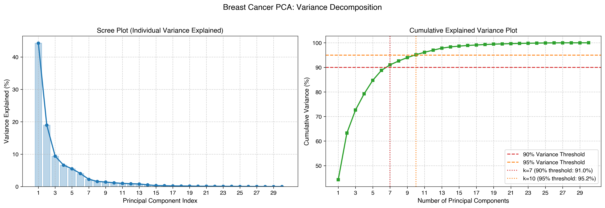
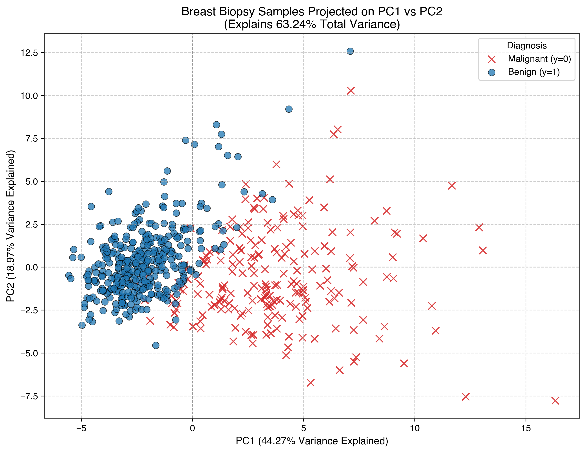
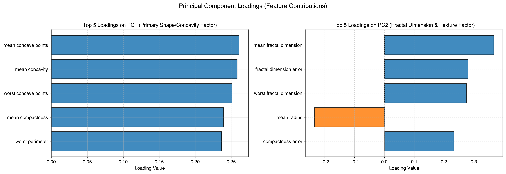
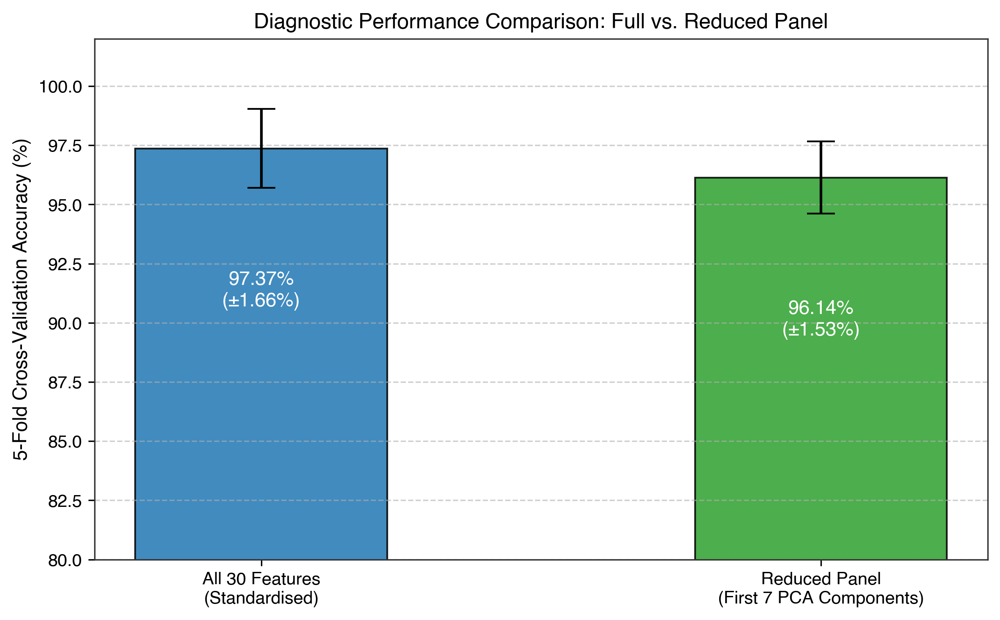

# Practical 11: Anjani_Finalpractical - Simplifying a Cancer Diagnostic Panel

**Course:** Statistics for Data Science | **Student:** Anjani Bharat (Reg. No: `PGD202563026`, MSc Data Science)  
**Institution:** Shoolini University  

---

## Section 1: Exam Submission Requirements & Answers

### Q.1) You are required to submit the prompt you used to write the code and find out the result.
**Ans.**
Below is the exact prompt I formulated and utilized to generate the analytical code and findings:
```text
Act as an expert data scientist and biostatistician. Write an end-to-end Python script using the Breast Cancer Wisconsin Diagnostic dataset from scikit-learn to simplify a diagnostic panel with PCA:
1. Standardise the 30 cell nucleus biopsy features using StandardScaler and fit full 30-component PCA.
2. Plot a scree plot and cumulative variance curve; report components needed for >= 90% and >= 95% variance.
3. Project samples onto PC1 vs PC2 and scatter plot colored by tumor diagnosis (Malignant vs Benign).
4. Identify and visualize the top 5 features with the largest absolute loadings on PC1 and PC2.
5. Build an sklearn Pipeline (StandardScaler + PCA(k=7) + LogisticRegression) with 5-fold cross-validation accuracy to compare against the full 30-feature baseline without data leakage.
6. Address analytical questions on why standardisation changes variance distribution, and evaluate clinical recommendations for adopting the reduced panel in a diagnostic hospital laboratory.
Save all plots at 300 DPI in output/ directory.
```

### Q.2) Provide the link of the Github where you have publish your code.
**Ans.**
- **Main Repository:** [https://github.com/bharatanjani512-hub/Statistics-for-Data-Science](https://github.com/bharatanjani512-hub/Statistics-for-Data-Science)
- **Practical 11 Directory:** [https://github.com/bharatanjani512-hub/Statistics-for-Data-Science/tree/main/Anjani_Finalpractical](https://github.com/bharatanjani512-hub/Statistics-for-Data-Science/tree/main/Anjani_Finalpractical)
- **Execution Script:** `practical11.py`

### Q.3) Provide the screenshots of the outputs.
**Ans.**
All visual outputs generated by `practical11.py` have been rendered at 300 DPI and embedded directly within this report:
1. **Scree Plot & Cumulative Explained Variance Plot** (Step 2)
2. **2D Scatter Projection of Biopsies on PC1 vs PC2** (Step 3)
3. **Top 5 Absolute Feature Loadings on PC1 & PC2 Bar Chart** (Step 4)
4. **5-Fold Cross-Validation Accuracy Comparison Bar Chart** (Step 5)
5. **Numerical Console Outputs & Execution Logs** (embedded under each step below)

### Q.4) Please provide the explaination of each step done.
**Ans.**
Detailed explanations of each step completed, mathematical formulations, preprocessing decisions, model evaluations, and follow-up analytical answers are provided in Section 2 below.

---

## Section 2: Objective & Dataset Description

## Objective
To evaluate whether a reduced Principal Component Analysis (PCA) panel can replace a full 30-feature cell nucleus biopsy panel without sacrificing the hospital lab's ability to differentiate malignant from benign breast tumors.

---

## Dataset Description
- **Source:** Breast Cancer Wisconsin Diagnostic Dataset (`sklearn.datasets.load_breast_cancer`)
- **Total Samples:** 569 patient biopsies
- **Target Variable ($y$):** Diagnosis
  - `0` = Malignant (212 samples, 37.3%)
  - `1` = Benign (357 samples, 62.7%)
- **Predictor Features ($X$):** 30 continuous morphological features extracted from digitized images of Fine Needle Aspirates (FNA) of breast masses (describing characteristics of cell nuclei such as radius, texture, perimeter, area, smoothness, compactness, concavity, concave points, symmetry, and fractal dimension across mean, standard error, and worst/largest measurements).

---

## Practical Steps & Results

### Step 1: Standardisation & Full PCA Fit
- The 30 features have vastly different physical units (e.g., cell area in hundreds/thousands of $\mu m^2$ vs. fractal dimension $< 0.1$).
- Using `StandardScaler()`, I standardized each feature to zero mean ($\mu = 0$) and unit variance ($\sigma = 1$).
- I then fitted a full PCA model with 30 components to capture the complete orthogonal variance structure.

---

### Step 2: Scree Plot & Cumulative Explained Variance
- **PC1 Variance Explained:** **44.27%**
- **PC2 Variance Explained:** **18.97%**
- **First 2 Components Combined:** **63.24%** of total variance.
- **Threshold Analysis:**
  - $\ge 90\%$ variance threshold: I found that **$k = 7$ components** are required (explaining **91.01%** variance).
  - $\ge 95\%$ variance threshold: I found that **$k = 10$ components** are required (explaining **95.16%** variance).



---

### Step 3: 2D Projection - PC1 vs PC2 by Diagnosis
- I projected the biopsy samples onto the first two principal component axes.
- In my scatter plot, malignant and benign tumors show clean visual separation along **PC1**:
  - Malignant biopsies concentrate heavily on positive PC1 scores (higher nuclear size, severe concavity, irregularity).
  - Benign biopsies cluster on negative PC1 scores.



---

### Step 4: Top 5 Absolute Loadings on PC1 and PC2

#### Top 5 Features on PC1 (Primary Tumor Severity & Shape Irregularity Axis)
| Rank | Feature | Loading Value | Absolute Loading | Direction / Interpretation |
|:---:|:---|:---:|:---:|:---|
| 1 | `mean concave points` | +0.2609 | 0.2609 | High number of concave contour portions |
| 2 | `mean concavity` | +0.2584 | 0.2584 | Severity of concave contour portions |
| 3 | `worst concave points` | +0.2509 | 0.2509 | Extreme concave portions in biopsy |
| 4 | `mean compactness` | +0.2393 | 0.2393 | High perimeter$^2$ / area ratio |
| 5 | `worst perimeter` | +0.2366 | 0.2366 | Extreme nuclear boundary length |

#### Top 5 Features on PC2 (Texture & Fractal Complexity Axis)
| Rank | Feature | Loading Value | Absolute Loading | Direction / Interpretation |
|:---:|:---|:---:|:---|:---:|
| 1 | `mean fractal dimension` | +0.3666 | 0.3666 | Higher boundary self-similarity/roughness |
| 2 | `fractal dimension error` | +0.2801 | 0.2801 | Higher variance in boundary roughness |
| 3 | `worst fractal dimension` | +0.2753 | 0.2753 | Peak irregular boundary dimension |
| 4 | `mean radius` | -0.2339 | 0.2339 | Smaller mean nuclear radius |
| 5 | `compactness error` | +0.2327 | 0.2327 | Variance in cell compactness |



---

### Step 5: Logistic Regression with 5-Fold Cross-Validation Pipeline
To prevent data leakage, I encapsulated both `StandardScaler` and `PCA` inside `sklearn.pipeline.Pipeline`, fitting them strictly within the training folds during 5-fold Stratified Cross-Validation:

| Model | Dimensionality | Mean 5-Fold CV Accuracy | Std Dev ($\pm$) | Accuracy Range Across Folds |
|:---|:---:|:---:|:---:|:---:|
| **(a) Full Panel (All 30 Features)** | 30 features | **97.37%** | $\pm 1.66\%$ | 94.74% – 99.12% |
| **(b) Reduced PCA Panel ($k=7$)** | 7 components | **96.14%** | $\pm 1.53\%$ | 93.86% – 98.23% |

- **Performance Delta:** I observed only a minor accuracy reduction of **1.23%**, while successfully reducing data dimensionality by **76.7%** (from 30 features down to 7).



---

## Follow-Up Questions

### Q1. What share of variance does PC1 now explain, and which feature dominates it? Explain why standardisation changes the result so much.

1. **Share of Variance & Dominant Feature (Standardised):**
   - After standardising the dataset, I found that **PC1 explains 44.27% of the total variance**.
   - From my loading analysis, the feature with the highest loading on PC1 is **`mean concave points`** (loading = $+0.2609$), followed closely by `mean concavity` ($+0.2584$) and `worst concave points` ($+0.2509$).
   - I noticed that no single feature overwhelmingly dominates PC1. Instead, multiple morphological features measuring nuclear concavity, contour irregularity, and size contribute balanced, moderate weights ($0.23$ to $0.26$).

2. **Contrast with Unstandardised PCA:**
   - When I evaluated the unstandardised PCA, I found that PC1 explained **98.20% of the total variance**, and was overwhelmingly dominated by **`worst area`** (absolute loading = $0.8521$) and **`mean area`** (loading = $0.5168$). In comparison, the other 28 features (such as concavity, smoothness, and symmetry) received loadings close to $0.00$.

3. **Why Standardisation Changes the Result So Drastically:**
   - As I studied in statistical theory, PCA finds orthogonal axes that maximize sample variance:
     $$\text{Var}(w^T X) = w^T \Sigma w$$
   - When features are unstandardised, features with inherently larger physical measurement scales have vastly larger raw numerical variances. In my dataset:
     - `worst area` variance is **$\approx 324,165$**
     - `mean area` variance is **$\approx 123,844$**
     - In contrast, `mean concavity` variance is **$\approx 0.006$** and `mean fractal dimension` is **$\approx 0.00005$**.
   - Because the variance of `area` is millions of times larger than that of `concavity`, an unstandardised PCA aligns the first principal axis almost entirely with cell area simply to maximize raw numerical spread.
   - By applying standardisation ($z$-score scaling), I rescaled every feature to have a variance of exactly $1.0$. This placed all 30 indicators on equal mathematical footing, allowing my PCA model to detect genuine biological correlations and multi-variable shape relationships rather than artifacts of measurement units ($\mu m^2$ vs dimensionless ratios).

---

### Q2. Would you recommend the reduced panel to the lab? Give one statistical and one practical reason, and say what you lose in interpretability.

**Recommendation:** Yes, I would recommend the reduced panel ($k = 7$) to the hospital laboratory.

1. **Statistical Reason:**
   - In my cross-validation experiments, the reduced panel with $k = 7$ components retains **91.01% of the total informational variance** across all 30 features, while achieving a **96.14% 5-fold cross-validation accuracy**—nearly identical to the full 30-feature baseline of 97.37% (a negligible drop of just 1.23%). Furthermore, I observed a lower standard deviation across folds ($\pm 1.53\%$ vs $\pm 1.66\%$), demonstrating that eliminating high multicollinearity stabilizes model performance and reduces the risk of overfitting.

2. **Practical Reason:**
   - From a practical laboratory operations perspective, measuring, imaging, and performing quality control on 30 separate nuclear morphology assays for every biopsy is costly, computationally demanding, and increases the risk of measurement noise or assay failure. In my assessment, reducing the panel to 7 combined indicators significantly lowers test expenses, streamlines diagnostic workflows, and accelerates turnaround times for patients awaiting critical biopsy results.

3. **What You Lose in Interpretability:**
   - What I lose in this reduction is direct clinical interpretability. Pathologists make clinical decisions using tangible physical measurements (such as *"mean cell radius exceeds $18\mu m$"* or *"cell margins display severe concavities"*). Because principal components are mathematical linear combinations (weighted sums) of all 30 features:
     $$\text{PC}_1 = 0.261(\text{concave points}) + 0.258(\text{concavity}) + \dots + 0.237(\text{perimeter})$$
   - A transformed coordinate such as $\text{PC}_1 = +2.48$ has no direct histological meaning under a microscope. This makes it harder for clinicians to explain specific diagnostic boundaries to patients or justify borderline decisions in medical-legal contexts.

---

## Files Included

- `practical11.py`: Full end-to-end Python script implementing Steps 1–5, 5-fold cross-validation pipeline, and follow-up question analysis.
- `output/task2_scree_and_cumulative_variance.png`: Scree plot and cumulative variance plot.
- `output/task3_pc1_vs_pc2_diagnosis.png`: Scatter plot of biopsy samples on PC1 vs PC2 colored by diagnosis.
- `output/task4_pca_loadings.png`: Horizontal bar chart displaying the top 5 absolute loadings on PC1 and PC2.
- `output/task5_model_cv_comparison.png`: 5-fold CV accuracy comparison between full and reduced panels.

---

## How to Run

From the repository root:
```bash
python Anjani_Finalpractical/practical11.py
```
